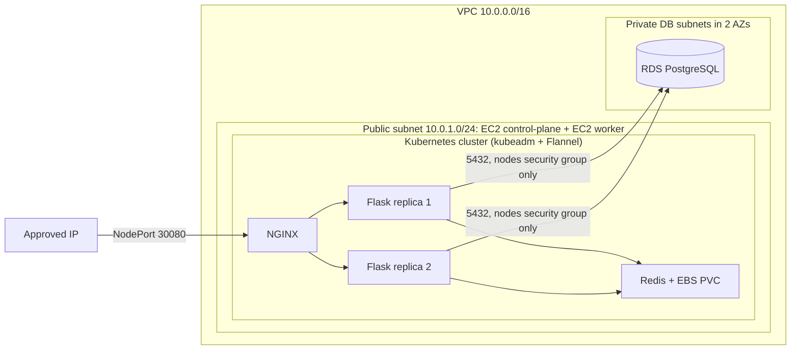

# Architecture (AWS)

Pod placement is decided by the Kubernetes scheduler, so the two Flask replicas normally land on different nodes.

**Access method:** the only exposed entry point is NodePort 30080 on the nodes, reachable only from the approved IP in the security group. SSH (22) is limited to the same IP.
